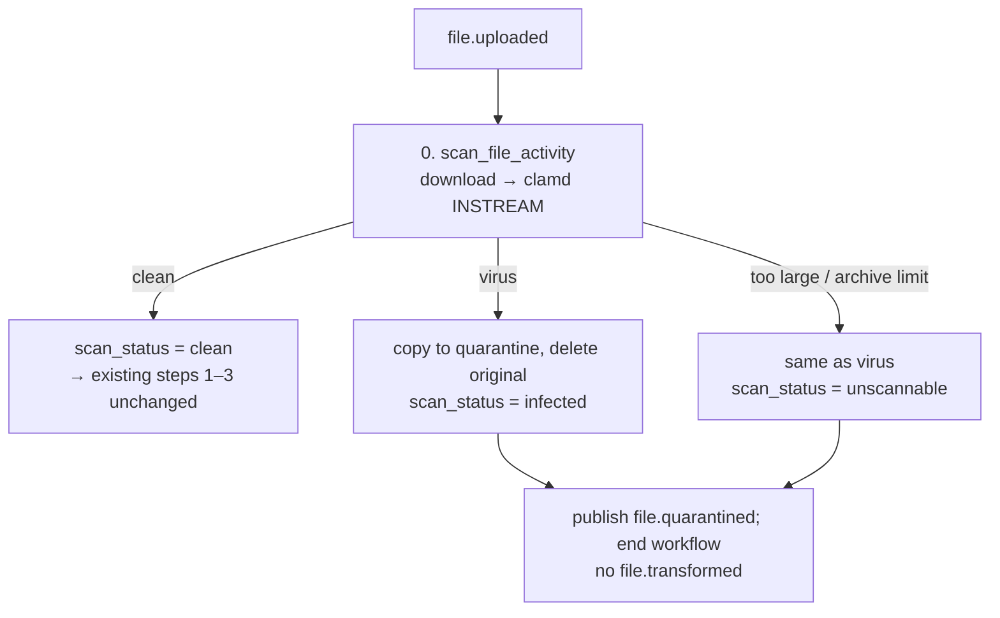

# Virus scanning of uploaded files (ClamAV) — design

Date: 2026-10-12 · Status: design approved in chat, awaiting spec review
Tracking: Vikunja CanTasks (project 4), label **Epic V — Virus Scanning**, cards #78–#81 (bucket *Parked*).

## Goal

Every file stored in the Appwrite bucket is scanned with ClamAV ([`clamav/clamav`](https://hub.docker.com/r/clamav/clamav)) before it is transformed or indexed. Infected or unscannable files are moved to a quarantine bucket and never reach the RAG pipeline (Weaviate / Neo4j / seeker search).

## Current flow

Five services write to the bucket and publish `file.uploaded` on `dapr-pubsub`:

| Producer | What it stores |
|---|---|
| platform40-webapp (`src/shared/adapters/appwrite_storage_adapter.py`) | user uploads |
| platform40-courier | email attachments |
| platform40-backoffice | generated markdown |
| platform40-pixelcraft | generated / edited images |
| platform40-wordcraft | generated / edited documents |

`file.uploaded` → **transformer** (`transformer_workflow`, Dapr Workflow) → `file.transformed` → **indexer**. Only transformer subscribes to `file.uploaded`.

## Decisions

| # | Question | Decision |
|---|---|---|
| 1 | Block the upload or scan afterwards | Scan after storage, driven by `file.uploaded`; no producer changes |
| 2 | On detection | Copy to an admin-only quarantine bucket, delete the original, flag the record |
| 3 | Index before the scan finishes? | No. Nothing is transformed or indexed until the file is scanned clean |
| 4 | Files that can't be scanned | Scanner limit = Appwrite upload limit (30 MB, `_APP_STORAGE_LIMIT`); anything still unscannable is quarantined as `unscannable` |
| 5 | Where the scanner lives | Inside platform40-transformer as the first workflow step (no new repo, no new event contract). Split out later if memory or scaling demands it |

Out of scope: rescanning files already in the bucket (no `scan_status` = treated as clean), blocking at upload time, and the stowage gap below.

## Design

### Flow

### platform40-transformer

- New activity `scan_file_activity`, called first in `transformer_workflow` (`src/application/workflow.py`). It downloads the file by `appwrite_file_id` and streams it to clamd over TCP (`INSTREAM`).
- Results:
  - `OK` → set `scan_status=clean`, continue with the existing steps.
  - `FOUND` → quarantine, set `infected`, publish `file.quarantined`, return without `file.transformed`.
  - Size or limit error → quarantine, set `unscannable`, same as `FOUND`.
- `file.quarantined` payload: `{file_metadata_id, workspace_id, reason: "infected"|"unscannable", signature}`.
- Settings (env): `CLAMAV_HOST`, `CLAMAV_PORT` (default 3310), `SCAN_ENABLED` (default `true`; `false` skips the step and keeps today's behaviour), `QUARANTINE_BUCKET_ID`.
- clamd config: `StreamMaxLength 30M`, matching `_APP_STORAGE_LIMIT`.
- Deployment:
  - Test server: a `clamav` service in `docker-compose.yml` with a 2 GB memory limit and a health check; transformer `depends_on` it being healthy.
  - GKE: clamav runs as a sidecar container in transformer's `deployment.yaml` (`localhost:3310`).
  - freshclam runs inside the official image.

### platform40-appwrite

- Add an optional `scan_status` attribute (enum `pending|clean|infected|unscannable`, no default) to `file_metadata` through the existing provisioning code.
- Add a `quarantine` bucket with no user or team permissions (admin key only).

### platform40-webapp

- `appwrite_storage_adapter.py`: download, view and preview are refused unless `scan_status` is `clean` or empty.
- File list and preview drawer show a badge: *Scanning…* (`pending`), *Removed: virus detected* (`infected`), *Could not be scanned* (`unscannable`).

## Failure handling

| Situation | Behaviour |
|---|---|
| clamd down or still loading signatures | Activity retries per the workflow retry policy, then goes to the existing failure path (`publish_failure_activity`). The file is never marked clean |
| Appwrite download fails | Same as above |
| Quarantine copy fails | Original is kept and marked `infected` (downloads blocked); the error is logged. No bytes are lost |
| Duplicate delivery | If `scan_status` is already `clean`, `infected` or `unscannable`, the scan is skipped |

Consequence of decision 3: while clamd is unavailable, new files wait and are not indexed.

## Rollout

1. **V1 (#78):** appwrite provisioning (field + bucket).
2. **V2 (#79):** transformer deployed with `SCAN_ENABLED=false`; `QUARANTINE_BUCKET_ID` set in the server `.env`.
3. **V3 (#80):** webapp badges and download block.
4. **V4 (#81):** set `SCAN_ENABLED=true`, restart transformer, smoke test.

## Testing

- **Transformer unit tests** with a fake clamd client: clean continues the workflow; infected is quarantined with no `file.transformed`; unscannable is quarantined; a failed quarantine copy keeps the original; a duplicate event skips the scan; `SCAN_ENABLED=false` is a no-op.
- **Smoke test on the test server:**
  - Upload the EICAR test file. Expect: in the quarantine bucket, `scan_status=infected`, badge shown in webapp, absent from seeker search.
  - Upload a normal PDF. Expect: `clean`, indexed as before.
  - Watch clamav memory and confirm it stays within its limit.

## Known gap (not addressed here)

platform40-stowage publishes `file.stowed` (Dropbox / Drive / SharePoint / FTP imports). Its docstring says transformer and indexer consume it, but no service subscribes, so imported files are neither transformed nor scanned today. When stowage files get routed into transformer, they pick up the scan automatically.
